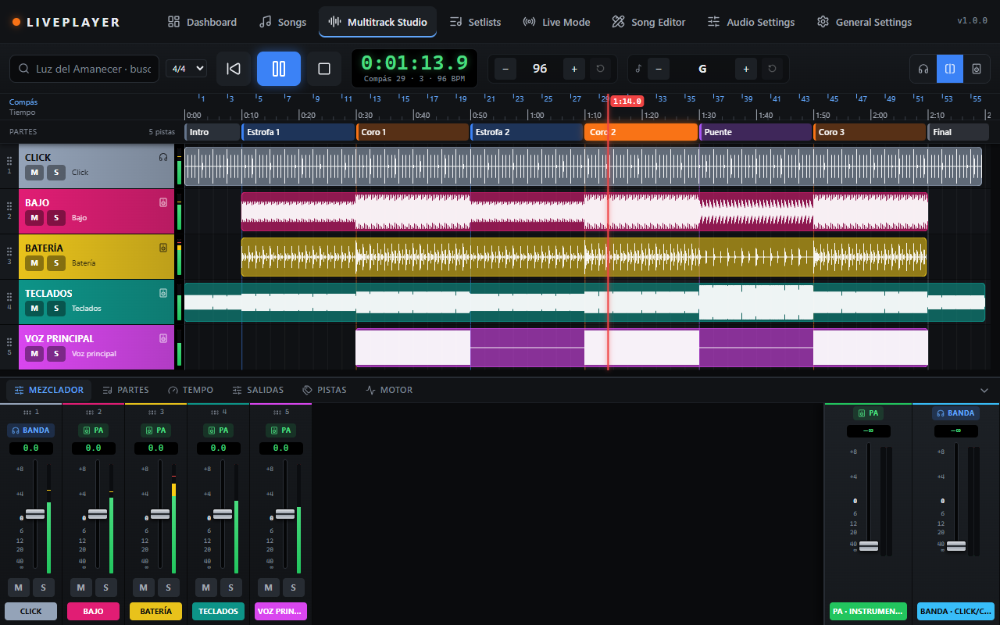
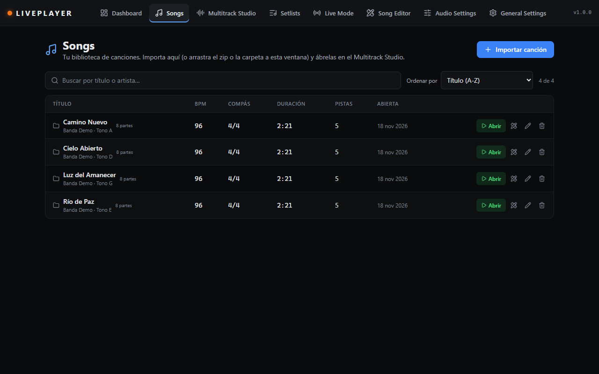
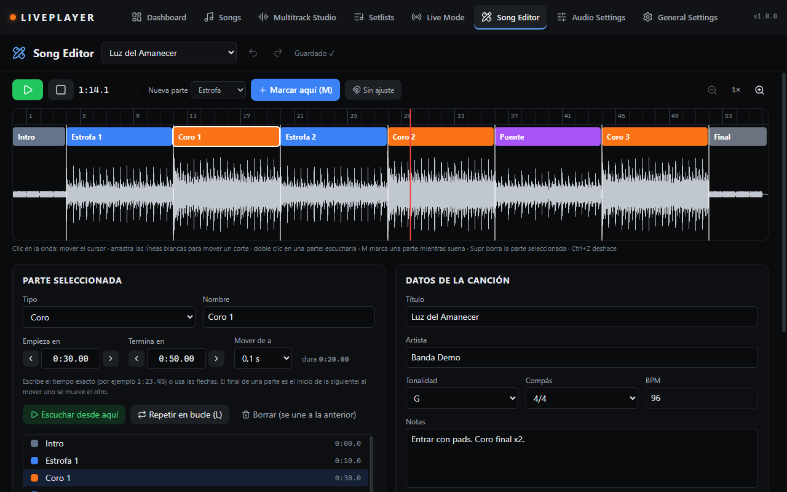
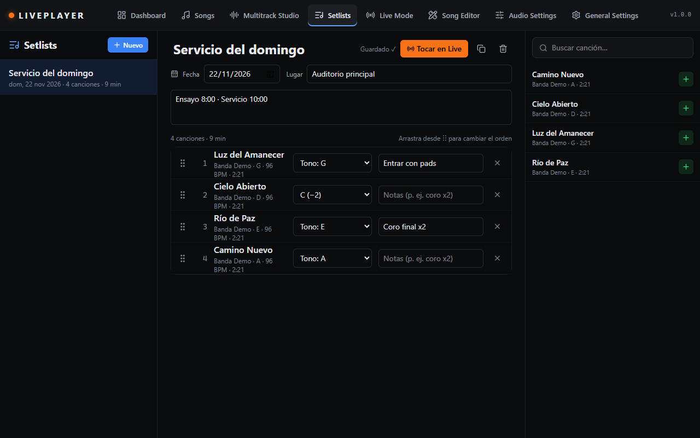
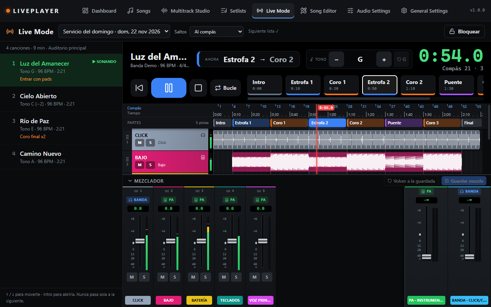

# LIVEPLAYER

**Reproductor multitrack para tocar en vivo**: iglesias, equipos de alabanza, bandas y conciertos.

Carga las pistas de cada canción (batería, bajo, teclados, voces, click, cues…), mézclalas, marca sus partes (intro, estrofa, coro, puente) y tócalas en vivo con el click y los cues por los in-ears de la banda y la música por la consola.

**Gratis, sin internet y sin suscripciones.** Windows y Mac. Versión **1.0.0**.



---

## Qué puedes hacer

| | |
|---|---|
| 🎚️ **Multitrack Studio** | Abre una canción y escucha todas sus pistas juntas. Volumen de cada pista hasta +8 dB, silenciar (M) y solo (S). La mezcla se guarda con la canción. |
| ⏱️ **Tempo y tono** | Cambia el tempo sin cambiar el tono, y el tono medio tono arriba o abajo sin cambiar el tempo. **El click y los cues nunca cambian de tono**, y las voces conservan su timbre natural. |
| 🧩 **Song Editor** | Marca dónde empieza y termina cada parte de la canción. Puedes escribir el tiempo exacto (con centésimas) o marcar mientras suena con la tecla **M**. Corrige el nombre y el instrumento de cada pista. |
| 📋 **Setlists** | Arma la lista de cada servicio o concierto: orden, tono de cada canción para ese día y notas para la banda. |
| 🔴 **Live Mode** | La pantalla para tocar. Saltos entre partes **sin cortes y a tiempo**, bucles, tono en vivo y bloqueo contra toques accidentales. **Nunca pasa sola a la siguiente canción.** |
| 🔊 **Salidas separadas** | Banda (instrumentos) → consola / PA. Click y cues → in-ears. Compatible con interfaces de audio (ASIO en Windows). |
| 💾 **Tu biblioteca segura** | Copia automática diaria y copia de seguridad en un .zip para llevar todo a otra computadora. |

---

## Cómo funciona

1. **Importas** una canción: un `.zip` o una carpeta con sus pistas (WAV, AIFF, FLAC, OGG o MP3). LIVEPLAYER reconoce cada pista por su nombre (Click, Bass, Drums, Keys…) y te deja corregirlo.
2. **La primera vez la prepara**: decodifica el audio, detecta el tempo y propone las partes de la canción. Desde la segunda vez abre en menos de un segundo.
3. **El motor de audio** (C++ con JUCE) suena por su cuenta, aparte de la pantalla, y nunca espera al disco mientras toca. Por eso un salto de parte llega justo al compás, sin clics ni cortes.
4. **Dos caminos de salida**:
   - **Banda**: lo que oye el público, por la consola.
   - **Click y cues**: solo para los in-ears de los músicos.

   En casa puedes juntarlo todo en audífonos (modo *Ensayo*).
5. **Todo queda en tu computadora**: canciones, mezclas, partes y setlists. No necesita cuenta ni internet.

---

## Guía rápida

### 1. Importar una canción
**Songs › Importar canción**, o arrastra el `.zip` o la carpeta a la ventana. Revisa que cada pista tenga el instrumento correcto, elige el tono original y pulsa **Guardar canción**.



### 2. Mezclar en Multitrack Studio
- Busca la canción en el buscador de arriba a la izquierda.
- **Espacio** reproduce o pausa · **Esc** detiene · **Inicio** vuelve al principio · **1–9** saltan a la parte 1, 2, 3…
- **Faders**: arrástralos, usa la rueda del ratón o las flechas. **Doble clic en el fader** lo deja en 0 dB; **doble clic en el número** te deja escribir los dB.
- **Tempo** y **Tono** están en la barra de arriba. La pestaña **Salidas** elige *Ensayo · todo junto*, *En vivo · 2 salidas* o *En vivo · 4 salidas*.

### 3. Marcar las partes en el Song Editor



- Elige el tipo (Estrofa, Coro, Puente…) y pulsa **Marcar aquí (M)** mientras suena, o haz clic en la onda para mover el cursor.
- Selecciona una parte y escribe su **inicio** y su **final** exactos (por ejemplo `1:23.45`), o ajústalos con las flechas ‹ › de a 1 tiempo, 0,1 s o 0,01 s. También puedes arrastrar las líneas blancas.
- **Ajuste al compás** (opcional) hace que los cortes caigan en el inicio de un compás.
- **Ctrl+Z** deshace y **Ctrl+Y** rehace. Todo se guarda solo.
- Abajo, en **Pistas**, corriges el nombre de cada audio y qué instrumento es.

### 4. Armar un setlist



**Setlists › Nuevo**. Agrega canciones desde la derecha, ordénalas arrastrando y, si quieres, elige el tono de cada una para ese día y agrega notas («entrar con pads», «coro x2»). Pulsa **Tocar en Live** para ir a Live Mode.

### 5. Tocar en Live Mode



- Elige el setlist y la canción. Ves la parte que suena, la que viene, el compás y el reloj en grande.
- Pulsa una parte para **saltar** a ella: *Al compás* (por defecto), *Al terminar la parte* o *Inmediato*.
- **Bucle** repite la parte actual hasta que lo quites.
- Los cambios de volumen en Live son **solo para ese momento**. Para conservarlos, pulsa **Guardar mezcla**.
- **Bloquear** evita tocar algo sin querer en pleno servicio.

| Tecla | Acción |
|---|---|
| Espacio | Reproducir / pausar |
| Mayús + Espacio | Detener (pide confirmación) |
| ← / → | Parte anterior / siguiente |
| L | Repetir la parte (bucle) |
| Esc | Cancelar el salto o el bucle |
| ↑ / ↓ + Intro | Elegir y abrir otra canción del setlist |

Los atajos se cambian en **General Settings**.

### 6. Conectar la interfaz de audio
En **Audio Settings** elige tu interfaz (en Windows, **ASIO** si el fabricante lo ofrece) y qué salida va a la banda y cuál al click. **Probar salidas** manda un tono para identificar cada canal en la consola. Si desconectas la interfaz, la canción sigue sonando por la salida de la computadora y LIVEPLAYER vuelve a la interfaz al reconectarla.

### 7. Copias de seguridad
LIVEPLAYER guarda solo una copia diaria de tu biblioteca. Para llevarla a otra computadora: **General Settings › Copia de seguridad › Guardar copia…** y, en la otra, **Restaurar copia…**.

---

## Instalar

**[Guía de instalación completa](docs/INSTALAR.md)**

- **Con la USB**: copia el instalador a la computadora e instálalo. En Windows es `LIVEPLAYER_1.0.0_x64-setup.exe` y en Mac un `.dmg`. Después la USB ya no hace falta.
- **Desde este repositorio**: instala las herramientas gratuitas que indica la guía y luego:

  ```bash
  git clone https://github.com/JJMELGAR04/Multittack-Player.git
  cd Multittack-Player
  npm run installer   # deja el instalador en instaladores/
  ```

**Requisitos:** Windows 10/11 de 64 bits o macOS 11 o posterior.

---

## Para desarrolladores

| | |
|---|---|
| Interfaz | React 19 + TypeScript + Tailwind CSS 4 |
| App de escritorio | Tauri 2 (Rust) |
| Motor de audio | C++20 + JUCE 9 (ABI en C, librería estática) |
| Datos | SQLite embebido (rusqlite) |

```
apps/desktop/            Interfaz React + app Tauri (src-tauri/)
crates/liveplayer-engine Puente seguro en Rust hacia el motor nativo
crates/liveplayer-db     Base de datos SQLite y migraciones
engine/                  Motor de audio C++/JUCE + pruebas nativas
docs/                    Instalación, arquitectura, plataformas, licencias, entorno
```

- [Instalación](docs/INSTALAR.md)
- [Entorno de desarrollo](docs/SETUP.md)
- [Arquitectura](docs/ARCHITECTURE.md)
- [Estrategia multiplataforma](docs/PLATFORMS.md)
- [Licencias](docs/LICENSING.md)
- [Estado del desarrollo](DEVELOPMENT_STATUS.md)

## Licencia
Software libre bajo la [GNU AGPL-3.0-or-later](LICENSE). Ver [docs/LICENSING.md](docs/LICENSING.md) y [THIRD_PARTY_NOTICES.md](THIRD_PARTY_NOTICES.md).
